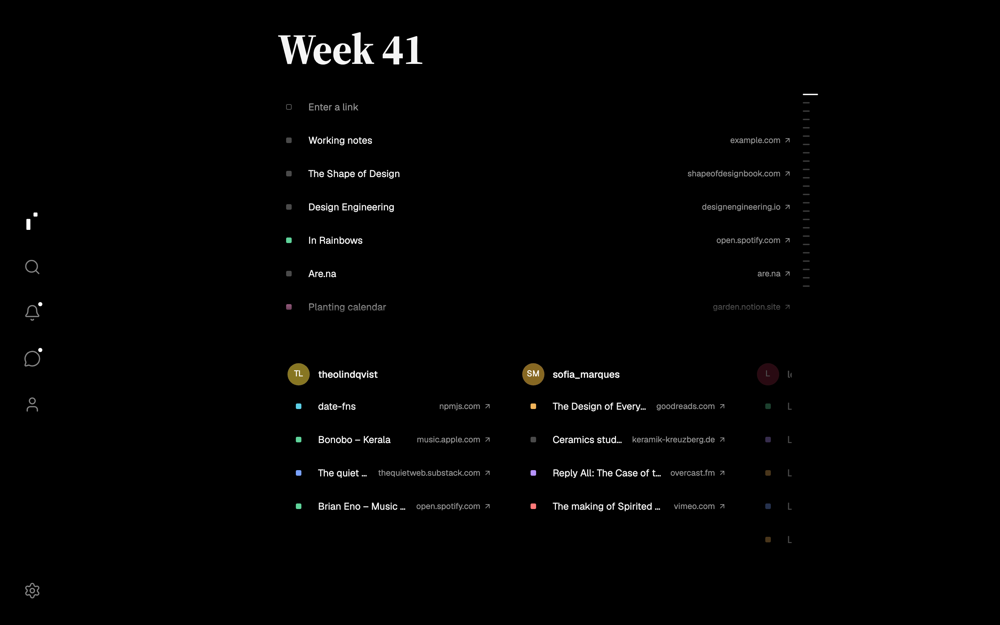

  

  <a href="docs/frontend.md">Web</a> ·
  <a href="docs/desktop.md">Desktop</a> ·
  <a href="apps/ios/README.md">iOS</a> ·
  <a href="docs/api.md">API</a> ·
  <a href="docs/deployment.md">Deployment</a>

Index is a calm place for the links worth keeping. Each week gets one page: what caught your eye, next to what the people you follow found.

You paste a link and Index files it under this week. Weeks don't scroll away: every one stays a page you can go back to.

  

## What You Can Do

- **Save a link by pasting it.** Index reads the title and marks it as an article, video, music, podcast, book, tool or note.
- **Read the week.** Your links on top, the people you follow below.
- **Go back in time.** Jump to any earlier week from the strip on the right.
- **Keep a library.** Your profile holds everything you saved, week by week, filtered by group, Favorites or Starred.
- **Find people.** Search by name, or follow who your people follow.
- **Talk about links.** Comment, mention someone with `@username`, or send a link in Messages.
- **Stay up to date.** Activity shows new comments, mentions, follows and requests.

## Apps

| Platform | Where                                       |
| -------- | ------------------------------------------- |
| Web      | Any modern browser                          |
| macOS    | Desktop app, see [desktop](docs/desktop.md) |
| iOS      | Native app, see [iOS](apps/ios/README.md)   |

## Privacy

Your profile is public or private. A private profile shows your links only to followers you approve. Locked groups stay yours, whatever your profile is set to.

## Development

Index is a Bun and Turborepo monorepo: a React web app, a Hono server on Cloudflare Workers, and a SwiftUI iOS app. Start with the [docs](docs/).

From the repository root, `bun dev` starts the Alchemy web/API development stack.
`bun dev:server` explicitly selects that same infrastructure task, including its web
companion; the server needs the Worker bindings that Alchemy supplies. Use
`bun desktop:dev` to start the stack together with the desktop app. Stop one before
starting another. App Quit or Ctrl-C stops the desktop development session and its servers.

`bun run --cwd apps/server build` produces the Worker bundle. Deployment and local
Worker execution use the infrastructure stack; there is no standalone Bun executable.

Run `bun run check-types` for the JavaScript workspaces. On a Mac with full Xcode and an available iPhone simulator, `bun run check:ios` compiles device and simulator builds with the Share extension, then runs Swift unit tests.

For feature setup and verification, see [authentication](docs/authentication.md), [link sharing](docs/sharing.md), [macOS menu bar](docs/menu-bar.md), [device appearance](docs/themes.md), and [notification delivery](docs/notifications.md).
