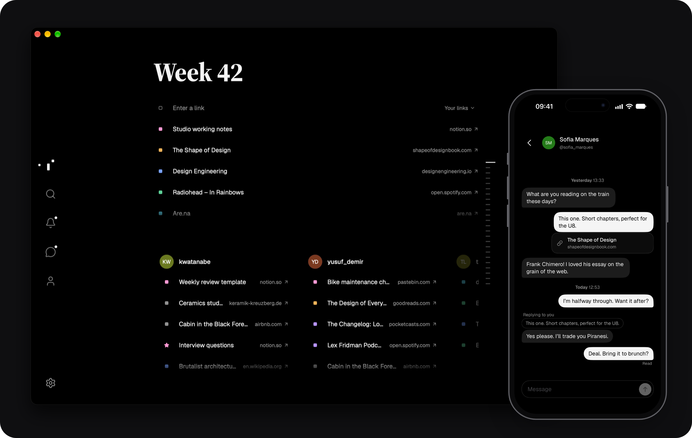
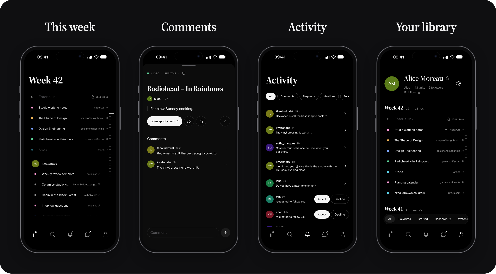

<p align="center">
  
</p>

<p align="center">
  <b>A calm place for the links worth keeping.</b>
</p>

<p align="center">
  <a href="https://github.com/generalpursuit/index/releases/latest">Mac, Windows and Linux</a> ·
  <a href="https://testflight.apple.com/join/kqYCvuq7">iPhone and iPad beta</a> ·
  <a href="https://index.generalpursuit.dev">Web</a>
</p>

<p align="center">
  
</p>

Index gives every week one page. Paste a link and it lands in this week, next to what the people you follow found. Earlier weeks stay one click away, so your links become a record of what caught your eye.

## Highlights

- **Save a link in a second.** Paste it, or share it from any app on your iPhone or Mac. Index reads the title and marks it as an article, video, music, podcast, book, tool or note.
- **Read the week.** Your links on top, your people's below. Jump to any earlier week from the strip at the side.
- **Keep a library.** Your profile holds everything you saved, week by week. Sort links into groups, keep your Favorites and star what others found.
- **Talk about links.** Comment, mention someone with `@username`, or send a link in Messages, with replies and read receipts.
- **Find your people.** Search by name or follow who your people follow. Activity shows new comments, mentions, follows and requests.
- **Share on your terms.** A private profile shares links only with followers you approve. Locked groups stay yours either way.
- **Bring your links along.** Import a curatee profile from Settings; each link lands in the week you saved it.

<p align="center">
  
</p>

## On every device

- **iPhone and iPad:** a native app with a share extension, notifications and a choice of Ink or Paper app icon.
- **Mac:** a menu bar panel to save a link without switching apps, the Share menu, notifications and launch at login.
- **Windows and Linux:** the same desktop app.
- **Web:** any modern browser, with notifications.

Your account, library and conversations are the same everywhere. Light and dark appearance follow your system, or choose one in Settings. The Mac, Windows and AppImage apps update themselves in the background.

## Get Index

| Platform        | Requirements                     | Download                                                                        |
| --------------- | -------------------------------- | ------------------------------------------------------------------------------- |
| Mac             | macOS 14, Apple silicon or Intel | [DMG](https://github.com/generalpursuit/index/releases/latest)                  |
| Windows         | 64-bit                           | [Installer](https://github.com/generalpursuit/index/releases/latest)            |
| Linux           | 64-bit                           | [AppImage, DEB or RPM](https://github.com/generalpursuit/index/releases/latest) |
| iPhone and iPad | iOS 17                           | [TestFlight beta](https://testflight.apple.com/join/kqYCvuq7)                   |
| Web             | A modern browser                 | [Open Index](https://index.generalpursuit.dev)                                  |

The Windows installer isn't signed yet, so Windows may warn about an unknown publisher.

## Development

Index uses Bun and Turborepo, with a React web/Tauri desktop app, a Hono API on Cloudflare Workers, and a SwiftUI iOS app.

Use the Bun version in [package.json](package.json) and configure the [local environment](docs/deployment.md#local-development), then run from the repository root:

```sh
bun install --frozen-lockfile
bun dev
```

The web app runs at `http://localhost:3000`; Alchemy supplies its API and database bindings. Use `bun desktop:dev` for the same stack with the desktop app. Stop one workflow before starting the other.

Common checks, from the root:

```sh
VITE_SERVER_URL=http://localhost:3002 bun run check-types
bun test packages/api/src apps/server/src
bun run check:ios
```

The type check builds the web app; the example API origin is for disposable tests. The iOS check requires macOS, full Xcode and an available iPhone simulator. See [web/desktop development](apps/web/README.md), [iOS development](apps/ios/README.md), and the [guide index](docs/README.md) for focused checks and operations.

## License

[Apache License 2.0](LICENSE)
